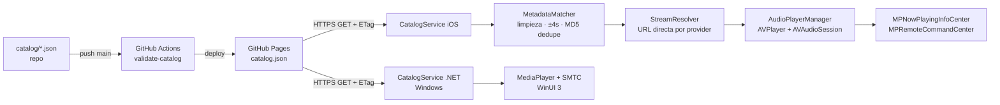

# Guía para desarrolladores

> Esta guía recoge la parte técnica que antes estaba en el README. Para instalar y usar Nsound, mira el [README](../README.md) o la [web](https://n1x0321.github.io/Nsound/).

## Plan por fases

| Fase | Objetivo | Hitos |
|------|----------|-------|
| 0 | Fundaciones | Repo, `.gitignore`, convenciones, JSON Schema del catálogo |
| 1 | Datos | Catálogo en GitHub Pages, validación en CI, normalizador (`MetadataMatcher`) |
| 2 | Reproducción | `AudioPlayerManager` (AVPlayer, segundo plano, pantalla de bloqueo) |
| 3 | UI | SwiftUI: biblioteca, búsqueda, cola, mini‑reproductor, vídeo (AVPlayerViewController) |
| 4 | Distribución | `build-ipa.yml` → `.ipa` sin firmar en GitHub Releases por tag `v*` |
| 5 | Windows | Núcleo .NET 8 (mismos 21 casos), app WinUI 3 con controles multimedia del sistema, `build-windows.yml` → `.zip` en la misma Release |

## Estructura

```
.
├── .github/workflows/
│   ├── build-android.yml      # Compila, firma y publica el .apk
│   ├── build-ipa.yml          # Compila y publica el .ipa; actualiza site/source.json
│   ├── build-windows.yml      # Tests .NET + zip portable e instalador .exe (x64, ARM64, x86)
│   └── validate-catalog.yml   # Valida catálogo y tests del normalizador
├── catalog/catalog.json       # Catálogo de ejemplo (servido por GitHub Pages)
├── schemas/catalog.schema.json
├── ios/
│   ├── project.yml            # XcodeGen
│   ├── LibreStream/
│   │   ├── App/               # LibreStreamApp.swift (punto de entrada)
│   │   ├── Models/            # Models.swift (reflejan el JSON Schema)
│   │   ├── Services/
│   │   │   ├── Catalog/       # CatalogService.swift
│   │   │   ├── Matching/      # MetadataMatcher.swift
│   │   │   └── Playback/      # AudioPlayerManager.swift
│   │   ├── Views/{Library,Player}/
│   │   └── Resources/
│   └── LibreStreamTests/
├── app/                       # Interfaz compartida iOS + Android (HTML/CSS/JS, sin dependencias)
│   ├── src/{js,css,eq.js,index.template.html}
│   ├── test/*.test.mjs        # Pruebas de Node (node --test app/test/core.test.mjs app/test/update.test.mjs)
│   ├── build.mjs              # Une todo en app/dist/index.html
│   └── dev/server.mjs         # Servidor local para probar en el navegador
├── android/                   # WebView + puente nativo (Kotlin) · APK en Releases
├── windows/
│   ├── LibreStream.Core/      # Models/, Services/{Catalog,Matching}/
│   ├── LibreStream.Core.Tests/# Matching/ (xUnit)
│   ├── LibreStream.App/       # Services/AudioPlayerManager.cs, Views/MainWindow
│   └── installer/nsound.iss   # Instalador de Windows (Inno Setup)
├── docs/MODIFICAR.md          # Guía: dónde tocar cada cosa
└── tools/
    ├── validate_catalog.py    # Validación JSON Schema + dedupe
    └── test_title_regex.py    # Casos borde de regex (espejo del Swift)
```

## Flujo de datos



> ¿Quieres modificar algo? Mira [docs/MODIFICAR.md](MODIFICAR.md).

## Desarrollo

```bash
python tools/test_title_regex.py && python tools/validate_catalog.py catalog/catalog.json
```

En Windows (requiere .NET 8 SDK): `dotnet test windows/LibreStream.Core.Tests` y `dotnet run --project windows/LibreStream.App -r win-x64 -p:Platform=x64`.

En macOS: `brew install xcodegen && cd ios && xcodegen && open LibreStream.xcodeproj`.

## Publicar una versión (para que llegue a todos)

Nsound no sale de ninguna tienda: **desde la beta 11**, cada app pregunta como máximo una vez al día a las
[Releases de GitHub](https://github.com/N1x0321/Nsound/releases) (incluidas las de pre-lanzamiento), compara con su versión y muestra
«Hay una versión nueva (x.y.z)». El botón «Descargar» abre la página de la Release; en Windows instalado con el `.exe` es
«Actualizar ahora» (ver más abajo). El aviso se puede descartar (vuelve con la siguiente).
No instala nada sin confirmación, no usa cuentas ni envía datos del usuario.

| Plataforma | Cómo se entera | Cómo se instala encima |
|---|---|---|
| Windows con instalador | Aviso en la app | «Actualizar ahora»: descarga, comprueba, pregunta, instala y vuelve a abrir. Los datos están en `%LocalAppData%\LibreStream` |
| Windows con zip portable | Aviso en la app | Descargar el zip, cerrar Nsound, extraer y abrir la carpeta nueva |
| Android | Aviso en la app | Descargar el APK y abrirlo: se instala encima (misma firma y `versionCode` mayor) |
| iPhone con la fuente en SideStore / AltStore | La tienda (`source.json`) y el aviso | Botón de actualizar en la tienda |
| iPhone con Sideloadly u otros | Aviso en la app | Descargar el IPA e instalarlo encima con el mismo Apple ID |
| Navegador | Aviso solo si se compiló con `NSOUND_VERSION` | Volver a desplegar |

La app solo anuncia una versión cuando la Release **ya tiene el fichero de su plataforma** (`-windows-<arch>-setup.exe` si se instaló
con el instalador, `-windows-<arch>.zip` si es portable, `-android.apk` o `-unsigned.ipa`), así que no importa que un flujo termine
antes que otro. `<arch>` es `x64`, `arm64` o `x86`, según el proceso que se está ejecutando.

### Windows: instalador y «Actualizar ahora»

`build-windows.yml` compila para cada arquitectura el zip portable y, con Inno Setup (`windows/installer/nsound.iss`), el instalador,
cada uno con su `.sha256`. No hace falta tener Inno Setup en tu PC: para probar una rama, lanza el flujo y descarga los artefactos.

```powershell
gh workflow run build-windows.yml -R N1x0321/Nsound --ref <rama>
```

- **Quién se actualiza solo:** las copias con `unins000.exe` y `unins000.dat` junto a `Nsound.exe`, es decir, las puestas con el instalador.
- **Qué hace la app** (`UpdateDownloader.cs`): pide primero el `.sha256` y después descarga el instalador a
  `%LOCALAPPDATA%\LibreStream\updates`. Si la huella falta o no coincide, no ejecuta nada y ofrece la descarga a mano. Solo pide
  `github.com/N1x0321/Nsound/releases/download/…` y, al redirigir, el almacén de ficheros de GitHub de **este** repositorio (por su número,
  `1453134198`). Si GitHub cambiara de almacén, la actualización automática fallaría sin instalar nada: habría que publicar una versión
  con la dirección nueva, y las instaladas tendrían que actualizarse a mano esa vez.
- **Cómo lanza el instalador:** `/SILENT /CLOSEAPPLICATIONS /RELAUNCH=1 /NORESTART`. Con `/RELAUNCH=1` el instalador vuelve a abrir Nsound.
- **Instalador:** siempre para el usuario actual (sin administrador) y Windows 10 1809 como mínimo. Si falta WebView2 Runtime, lo descarga
  de Microsoft y lo instala. Al actualizar y al desinstalar no toca `%LOCALAPPDATA%\LibreStream` (en su carpeta `updates`, la app borra
  los instaladores ya usados).
- **Límite:** la huella sale de la misma Release, así que protege de descargas rotas o cambiadas por el camino, **no** de alguien que
  entrara en la cuenta de GitHub. Eso solo lo resolvería firmar los instaladores. Protege la cuenta con verificación en dos pasos.
- **x86:** ONNX Runtime no publica binario de Windows de 32 bits, así que no se usa la red S-KEY; el tono lo calcula `KeyBpmAnalyzer`.

### Una sola vez: la firma de Android

Android solo instala una versión encima de otra si las dos llevan la **misma firma**. La clave está fuera del repositorio, en
`C:\Users\Usuario\Desktop\claudio\claves-nsound\`. **Haz una copia de seguridad de esa carpeta fuera del PC**: si se pierde la clave,
nadie podrá actualizar y habrá que desinstalar. Nunca se sube al repositorio.

GitHub necesita cuatro secretos (`ANDROID_KEYSTORE_B64`, `ANDROID_KEYSTORE_PASSWORD`, `ANDROID_KEY_ALIAS`, `ANDROID_KEY_PASSWORD`):

```powershell
gh secret set -f "C:\Users\Usuario\Desktop\claudio\claves-nsound\secrets.env" -R N1x0321/Nsound
```

Sin ellos, las compilaciones de rama y de pull request se firman con la clave de depuración, y **una etiqueta `v*` falla** en Android.
El registro de la compilación muestra la huella SHA-256 del certificado; en las versiones publicadas debe ser siempre:

`f4ab3c8805424724837e4ec48afe21d25a0807738228ff375a2dd9689c75418c`

### Cada versión

1. Lleva los cambios a `main` con un pull request.
2. Etiqueta con un número **mayor que el anterior**. Solo se admiten `vX.Y.Z`, `vX.Y.Z-beta.N` y `vX.Y.Z-rc.N`:

   ```bash
   git tag v0.8.0-beta.11 && git push origin v0.8.0-beta.11
   ```

3. Los tres flujos `build-*.yml` ponen la versión de la etiqueta dentro de cada app y suben los ficheros a la Release. No hay que editar números a mano.

   | | Versión de la app | Número que crece |
   |---|---|---|
   | Windows | la etiqueta (`-p:Version`) | — |
   | Android | `versionName` = la etiqueta | `versionCode` = 100 + número de ejecución de `build-android.yml` |
   | iPhone | `CFBundleShortVersionString` = `0.8.11` para `beta.11` (la etiqueta se guarda en `NsoundVersion`) | `buildVersion` = número de ejecución de `build-ipa.yml` |

   iOS solo entiende tres números y SideStore / AltStore comparan esa versión: el tercero es *parche × 1000 + beta* (la final es 999),
   de modo que `0.8.0-beta.11` → `0.8.11`, `0.8.0` → `0.8.999` y `0.8.1-beta.1` → `0.8.1001`. Ver `tools/ios_version.py`.

4. Comprueba:
   - La Release tiene los 16 ficheros (APK, IPA y, de Windows, tres zips y tres instaladores; cada uno con su `.sha256`) y **no** está en borrador.
   - Desde la versión anterior instalada con el `.exe`, «Actualizar ahora» deja la nueva abierta (el aviso se consulta una vez al día:
     para verlo al momento, borra `%LOCALAPPDATA%\LibreStream\updates.json`).
   - La huella del certificado en el registro de Android es la de arriba.
   - `site/source.json` en `main` tiene la versión nueva la primera y conserva las anteriores. Si el flujo avisó de que no pudo actualizarla,
     hazlo a mano (con los datos del `.ipa` y su `.sha256`) y súbelo a `main`:

     ```bash
     python tools/make_source.py --tag v0.8.0-beta.11 --version 0.8.11 --build <ejecución> --ipa Nsound-0.8.0-beta.11-unsigned.ipa --sha256 <hex> --size <bytes>
     ```

### Las webs

| Web | Qué hacer en cada versión |
|---|---|
| [Página de descargas](https://n1x0321.github.io/Nsound/) (`site/index.html`) | A mano: enlaces de descarga, tamaños y recuadro «Beta». Se publica al llegar a `main` |
| `source.json` y `catalog.json` (misma web) | `source.json` lo actualiza `build-ipa.yml`. **No cambies estas direcciones:** las apps instaladas las usan |
| [README](../README.md) e [INSTALAR](INSTALAR.md) | A mano: tabla de descargas y versión de cada plataforma. La primera vez que haya instalador, usa los [textos preparados](TEXTOS-INSTALADOR.md) |
| [Demo en el navegador](https://nsound-demo.vercel.app/) | Despliegue manual de `app/dist/index.html`. Compílala **sin** `NSOUND_VERSION` para que no pida descargar nada |
| Servidor de pruebas (`render.yaml`) | Compila sin versión: no muestra el aviso |

### Solo en la beta 11: instalación a mano

Las betas 10 y anteriores **no tienen avisador**: hay que decirlo en la web y en las notas de la Release.

- **Windows:** descargar el zip de la beta 11. La biblioteca se conserva.
- **Android:** el APK nuevo **no se puede instalar encima** de los anteriores (iban firmados con claves de depuración). Hay que
  **exportar la biblioteca** (Biblioteca → Exportar), desinstalar, instalar la beta 11 e importar el archivo. Al desinstalar se borran
  también las descargas, el historial y los ajustes.
- **iPhone:** con la fuente añadida en SideStore / AltStore, `0.8.11` aparece como actualización sobre el `0.8.0` instalado. Con otros métodos, instalar el IPA a mano.

### Para no romper las actualizaciones

- No cambies la clave de Android ni el identificador de las apps.
- No cambies el `AppId` de `nsound.iss`, el nombre de los instaladores ni el formato de su `.sha256` (`<hex>  <fichero>`): las copias instaladas dependen de ellos.
- No renombres ni recrees `build-android.yml` o `build-ipa.yml`: su número de ejecución volvería a empezar.
- No cambies el nombre del repositorio ni de la cuenta: las apps preguntan a `N1x0321/Nsound`.
- Las compilaciones locales y de rama llevan la versión `0.0.0-dev` y no avisan (el instalador de una rama sirve para probar la instalación, no el aviso). Para probar el aviso: `-p:Version=0.8.0-beta.9` (Windows) o
  `NSOUND_VERSION=0.8.0-beta.9 node app/build.mjs` (navegador). Se consulta una vez al día: para repetir, borra `updates.json` (Windows) o la clave `ls.update` (navegador).

## Notas de versiones anteriores

> **Fuentes de contenido:** el catálogo solo debe apuntar a contenido que se tenga derecho a
> redistribuir (dominio público, Creative Commons, Internet Archive, Jamendo, Free Music Archive,
> material propio…). El campo `source.provider` admite `youtube` únicamente como *referencia de
> metadatos/embebido oficial*; este repo **no** incluye extractores de streams de terceros.

> **YouTube (Windows):** al buscar, los resultados de YouTube aparecen como tarjetas dentro de la app y se
> reproducen con el reproductor oficial embebido (IFrame Player API), controlado por la barra de la app
> (play/pausa, anterior/siguiente, progreso, volumen). Se pueden guardar en «Mi biblioteca».
> No se extraen ni descargan streams.

> **Windows:** Inicio con éxitos del momento, Música por géneros (solo sonido), vídeos libres, letra sincronizada
> (LRCLIB, base de datos abierta), Mi biblioteca y listas de reproducción propias. Sin cuentas ni suscripciones.

> **Windows 0.5:** Vídeos con estanterías (La Velada del Año, series, YouTubers, deporte…), filtros estrictos
> (Música solo canciones y sin vídeo; Vídeos solo vídeos), anuncio de lanzamientos nuevos en Inicio, ecualizador de 10 bandas,
> descargas del catálogo libre (Creative Commons) y ajustes guardados. YouTube no se descarga: se reproduce con su reproductor oficial.

> **iOS y Android (0.5):** una única interfaz web (`app/`) con todas las funciones —Inicio con lanzamientos de la semana,
> Música por géneros, Vídeos con estanterías, Biblioteca y listas, letras sincronizadas, ecualizador, descargas del
> catálogo libre— dentro de una app nativa pequeña (`ios/` con WKWebView, `android/` con WebView).
> Windows sigue siendo nativo (WinUI 3) y comparte `app/src/eq.js`. Las apps móviles se compilan en GitHub Actions;
> aún no se han probado en un dispositivo real.

